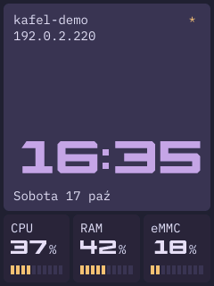
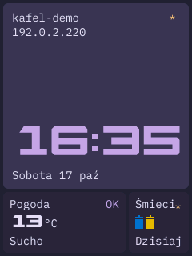
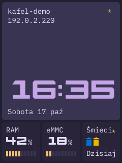

# Kafel

**Mały ekran. Zegar, stan urządzenia i kafle niezależnych usług.**

Kafel to dashboard dla M5Stack CM4Stack z pionowym ekranem dotykowym 240×320 px
oraz zestaw małych demonów dostarczających mu dane. Duży kafel pokazuje godzinę,
datę, nazwę hosta i adres IPv4. Pod nim znajduje się przewijana wstążka:
CPU, RAM, zajętość dysku i kafle usług — obecnie Pogoda oraz Śmieci.

Interfejs jest przeznaczony do odczytu z małego ekranu wiszącego na ścianie.
Ma duże cyfry, polskie podpisy, paletę Rosé Pine Moon, zaokrąglone kafle bez
obramowań i spokojne animacje. Dotyk służy do nawigacji, nie do wprowadzania danych.

Projekt jest napisany w **C++20**, budowany i cross-kompilowany przez **Zig**.
Renderer działa programowo i zapisuje obraz bezpośrednio do framebuffera Linux.
Nie wymaga przeglądarki, serwera graficznego ani GPU. Dashboard, pogoda i śmieci
są osobnymi procesami i można je aktualizować niezależnie.

Kafel zastępuje projekty `cm4stack-dashboard` i `infohub`. To repo zawiera
aktualną implementację C++; do budowania i działania nie potrzebuje ich źródeł.

## Podgląd

<p>
  
  
  
</p>

Obrazy 240×320 pochodzą z renderera aplikacji i używają przykładowych danych.
Od lewej: metryki systemowe, Pogoda ze Śmieciami oraz Śmieci jako jedyna usługa.


## Co widać na ekranie

- **Zegar:** HH:MM z animowanym przesuwaniem cyfr; data z pełną nazwą dnia
  tygodnia, bez roku. Hostname i sam adres IP mają po 14 px; brak adresu
  pozostawia pusty wiersz.
- **Metryki systemowe:** CPU, RAM i eMMC albo DISK, z dużą wartością procentową
  oraz segmentowym słupkiem. Metryka dysku dotyczy systemu plików `/`.
- **Wstążka:** kafle jednej, dwóch lub trzech kolumn, prowadzone za palcem,
  z bezwładnością, oporem na krańcach i dosuwaniem do kafla. Po 60 sekundach
  bezczynności wraca do początku, do metryk systemowych.
- **Pogoda:** dwie kolumny, duża temperatura z °C; na dole kolejno opis warunków,
  wiatr w m/s i słupek wiatru. Skala słupka jest liniowa: 0–32,7 m/s.
- **Śmieci:** domyślnie jedna kolumna, kolorowe kubły i podpis `Dzisiaj`, `Jutro`
  albo data najbliższego odbioru. Kubły i podpis zmieniają się razem.
- **Stan usług:** osobne ostrzeżenia, awarie i utrata komunikacji. Flaga uwagi
  daje gwiazdkę przy zegarze i tytule kafla; nie przejmuje nawigacji użytkownika.

Bez producentów wstążka nadal zawiera CPU/RAM/dysk. Aplikacja nie uruchamia
scen demonstracyjnych ani sztucznych alarmów.

## Wymagania

Na komputerze budującym:

- **Zig 0.17.0** — wersja używana do budowania i testów projektu;
- Python 3 do testów integracyjnych oraz narzędzi wdrażania;
- klient OpenSSH (`ssh`, `scp`) do wdrażania;
- dla osobnych testów HTTPS: Python z TLS 1.3 i pakietem `cryptography`.

Na urządzeniu:

- Linux ARM64 z systemd, Pythonem 3 i `sudo`;
- działający framebuffer LCD: **240×320, little-endian RGB565**, bez przesunięcia
  widocznego obrazu; stride może uwzględniać padding;
- dostępny ekran dotykowy evdev z `INPUT_PROP_DIRECT`, `ABS_X`, `ABS_Y`
  i `BTN_TOUCH`; urządzenie jest wyszukiwane w `/dev/input/event*`, opcjonalnie dotyk można wyłączyć;
- nie-rootowe konto usług z dostępem do grup `video` i `input`;
- dla Pogody: sieć, poprawny zegar i systemowy zestaw certyfikatów CA;
- dla Śmieci: plik harmonogramu i systemowa baza stref `/usr/share/zoneinfo`.

Statyczne binarki ARM64/musl powstają na komputerze deweloperskim. Na CM4
nie trzeba instalować Zig, kompilatora C++ ani bibliotek developerskich.
Obecna aplikacja ma stały układ 240×320; przenośne komponenty UI nie oznaczają
jeszcze gotowego wsparcia innych ekranów.

## Szybki start bez urządzenia

Z katalogu repozytorium:

```sh
zig build test -Doptimize=ReleaseFast
zig build preview -Doutput=/tmp/kafel.ppm -Doptimize=ReleaseFast
zig build preview -Dweather=true -Doutput=/tmp/kafel-weather.ppm -Doptimize=ReleaseFast
```

`preview` zapisuje PPM 240×320 przy użyciu tego samego widoku i renderera co
aplikacja. Korzysta ze stałych danych przykładowych i nie otwiera framebuffera.
Podgląd nie jest zrzutem bieżącego stanu urządzenia.
Scenę Śmieci można wybrać przez `-Dscene=waste`.

Galerię PNG/GIF odtworzysz poleceniem:

```sh
python3 scripts/render_previews.py
```

Eksport wymaga Pillow w używanym interpreterze Python. Wszystkie piksele
rysuje C++: Pillow jedynie koduje obrazy. GIF ma 6 s i źródłowe klatki co 40 ms;
syntetyczne gesty przechodzą przez ten sam kontroler wstążki co dotyk.
Polecenie nie łączy się z CM4, nie pobiera danych i nie wdraża aplikacji.


## Budowanie

| Polecenie | Wynik |
|---|---|
| `zig build` lub `zig build linux` | `zig-out/linux-arm64/kafel-dashboard` |
| `zig build weather-linux` | `zig-out/linux-arm64/kafel-weather` |
| `zig build waste-linux` | `zig-out/linux-arm64/kafel-waste` |
| `zig build weather` | Natywny `zig-out/bin/kafel-weather` |
| `zig build waste` | Natywny `zig-out/bin/kafel-waste` |
| `zig build linux-tests` | Buduje ARM64 `kafel-socket-tests`; nie uruchamia go na urządzeniu |

Targety `*-linux` używają ARM64/musl i ReleaseSmall. Natywne programy i testy
przyjmują `-Doptimize=ReleaseFast` lub `ReleaseSmall`. Współdzielone biblioteki
są wkompilowane w aplikacje, a font jest osadzony w dashboardzie.

## Parametry dashboardu

| CLI | Zmienna środowiska | Domyślnie |
|---|---|---|
| `--fb=auto\|/dev/fbN` | `KAFEL_FRAMEBUFFER` | `auto` |
| `--touch=auto\|/dev/input/eventN\|off` | `KAFEL_TOUCH` | `auto` |
| `--socket=/absolute/path` | `KAFEL_DASHBOARD_SOCKET` | `/tmp/dashboard-v2-<uid>/status.sock` |
| `--idle-timeout=SECONDS` | `KAFEL_IDLE_TIMEOUT` | `60`; zakres 0–86400 s, `0` wyłącza powrót |

CLI ma pierwszeństwo przed środowiskiem, potem stosowane są wartości domyślne.
`auto` wybiera jedyny framebuffer zgodny z formatem LCD, nie pierwszy numer.
Przy dwóch zgodnych ekranach start kończy się błędem z prośbą o `--fb`.
`--display-info` wypisuje wybrane urządzenie bez blokowania i rysowania.
Pozostałe kontrole sprzętu używają tych samych ustawień co normalny start.
Nie ma automatycznej zmiany rozdzielczości ani konwersji obcego formatu.

Przy wdrażaniu ustawienia zapisują się w `/etc/kafel/dashboard.env`.
Instalator przyjmuje `framebuffer`, `touch`, `dashboard_socket` i `idle_timeout`
w `deploy.local.json` (wartości jako napisy). Zmiana adresu gniazda wymaga
wspólnego wdrożenia dashboardu i zainstalowanych producentów; ich konfiguracja
otrzymuje ten sam adres.

## Wdrożenie

Utwórz lokalną konfigurację:

```sh
cp deploy.example.json deploy.local.json
```

Ustaw `host` i `user`. Plik jest ignorowany przez Git. Dla pierwszego wdrożenia
Pogody podaj również `latitude` i `longitude` jako napisy z liczbami.
Dla Śmieci `waste_schedule` wskazuje **już istniejący plik na CM4**.

```json
{
  "host": "cm4stack.local",
  "user": "your-user",
  "latitude": "52.0",
  "longitude": "17.0",
  "waste_schedule": "/home/your-user/kafel-data/garbage_schedule.json",
  "waste_span": "1"
}
```

Współrzędne są przykładowe. Instalator nie przesyła harmonogramu; należy
przygotować go osobno według [formatu kafel-waste](apps/waste/README.md).
Na istniejącej instalacji zachowuje konfigurację usług i dotychczasowy plik.

```sh
zig build deploy-dashboard
zig build deploy-weather
zig build deploy-waste
```

Przy pierwszej instalacji zacznij od dashboardu. Producenci wymagają
uruchomionego dashboardu. `zig build deploy` instaluje cały zestaw, jeśli
przygotowane są ustawienia Pogody i harmonogram Śmieci.

Każde polecenie testuje i buduje wybraną aplikację. Niezmieniona binarka nie
jest ponownie przesyłana; zgodność binarki, jednostki, konfiguracji i stanu
usługi pozwala pominąć restart. Aktualizacja jednej aplikacji nie restartuje
pozostałych. Przy błędzie transakcji instalator przywraca poprzednie wydanie,
pliki i stan zmienianych usług.

Hasła SSH/sudo wpisuje się w terminalu. Narzędzie pokazuje cztery krótkie
etapy, a szczegóły i archiwum odzyskiwania zapisuje lokalnie w ignorowanym
`deploy-results/`. Skrypty wdrażania nie wykonują operacji Git.

Pełny opis: [konfiguracja, systemd, pomijanie zmian i rollback](docs/deploy.md).

## LCD dla dashboardu, HDMI dla konsoli

Dashboard rysuje na LCD, a konsola tekstowa korzysta z HDMI. Samo
`console=tty2` nie rozdziela ekranów: tty1 i tty2 mogą być przypisane do tego
samego framebuffera. `fbcon=map:2` oznacza fb2, nie tty2.

Podczas `deploy-dashboard` (lub wspólnego `deploy`) instalator automatycznie
przygotowuje `/boot/firmware/cmdline.txt`, jeśli plik istnieje i DRM zgłasza
HDMI-A-1. Zachowuje parametr dysku `root=`, konsolę szeregową oraz pozostałe
ustawienia, usuwa dotychczasowe `fbcon=map...` i ustawia:

```text
console=tty2 video=HDMI-A-1:640x480@60D
```

To fragment **jednej istniejącej linii**, nie cała zawartość `cmdline.txt`.
`D` wymusza cyfrowe HDMI również bez podłączonego monitora. Instalator
nie nadpisuje innego istniejącego trybu HDMI-A-1: zatrzymuje wtedy preflight.
Oryginalny plik trafia do lokalnego archiwum odzyskiwania; błąd transakcji
przywraca go automatycznie. Narzędzie informuje o potrzebnym reboocie,
ale nigdy go samo nie wykonuje. Ręczna edycja nie jest częścią zwykłego wdrażania.

Przed każdym startem dashboardu `ExecStartPre` uruchamia krótkie narzędzie
systemowe, które wykrywa i weryfikuje framebuffer HDMI oraz kieruje tam fbcon.
Nie zakłada, że HDMI to fb1, ani że LCD to fb0. Jeśli nie ma potwierdzonego
HDMI, odłącza fbcon od ekranów, chroniąc LCD także przed pierwszym rebootem.
Częściowy błąd przywraca wcześniejszy stan i blokuje start dashboardu.
Tylko to narzędzie działa jako root; właściwy dashboard pozostaje nie-rootowy.
Ochrona pozostaje aktywna po zatrzymaniu lub awarii aplikacji.

Po restarcie sprawdź na CM4:

```sh
cat /proc/fb
sudo cat /run/kafel-display/status.json
```

`mode: hdmi` oznacza potwierdzone przekierowanie konsoli; `lcd` i `console`
podają osobne urządzenia. Przykładowy wynik to LCD `fb_st7789v` na `/dev/fb0`
i HDMI `vc4drmfb` na `/dev/fb1` — numery mogą być inne. `mode: detached` oznacza,
że fbcon jest odłączony; diagnostyka nadal działa przez SSH/journal i konsolę
szeregową. Nie jest to potwierdzenie działającego wyjścia konsoli na HDMI.

`flock` nie blokuje obcego programu piszącego bezpośrednio do fbdev, dlatego
LCD powinien mieć jednego autora. Szczegóły wykrywania, przywracania konsoli,
parametrów kernela i ograniczeń: [konfiguracja CM4Stack](docs/cm4stack.md).

## Jak to jest zbudowane

```text
apps/
  dashboard/       widok, pętla zdarzeń, framebuffer, evdev, dane Linux
  weather/         Open-Meteo, walidacja, cache i ponawianie
  waste/           lokalny harmonogram, kalendarz i wybór odbioru
libs/
  ui/              fonty, kafle, siatka, wstążka i cykle podpisów
  dash-protocol/   model usług, parser DASH/4, rejestr i Unix publisher
  http-client/     synchroniczny GET z weryfikacją TLS
  json/            ograniczony parser dokumentów nad picojson
vendor/            przypięte zależności i ich licencje
packaging/systemd/ jednostki kafel-*.service
scripts/           wdrażanie, audyt i testy instalatora
```

`DashboardView` komponuje widok z danych systemowych i ogólnych modeli kafli.
Nie pobiera pogody i nie interpretuje frakcji śmieci. `LinuxSystemProbe`
odczytuje system; adaptery framebuffer/evdev odpowiadają za sprzęt.
Biblioteka `ui` nie zależy od Linux ani domeny usług.

Producenci oddzielają model i politykę od transportu: dane są walidowane,
potem zamieniane na snapshot DASH/4, a na końcu wysyłane wspólnym publisherem.
Usługi nie zależą od siebie. Wspólny HttpClient nie zawiera retry ani JSON;
te decyzje należą do aplikacji.

Więcej: [architektura i ograniczenia implementacji](docs/architecture.md).

## Protokół usług

**DASH/4** to lokalny protokół tekstowy przez Unix datagram. Jeden komunikat
zawiera pełny zestaw kafli jednej usługi; poprawna aktualizacja zastępuje go
atomowo. Jedna usługa może publikować wiele kafli, każdy o własnym ID,
szerokości, stanie i fladze uwagi.

Dostępne treści:

| Typ | Prezentacja |
|---|---|
| `text` | Kolorowany tekst, opcjonalnie dwa niezależnie przewijane wiersze |
| `metric` | Duża liczba, jednostka i do trzech zmieniających się podpisów |
| `metric-meter` | Duża liczba, jednostka, do dwóch podpisów i słupek jako ostatnia strona |

Usługa deklaruje treść; dashboard ustala geometrię i typografię. Nie ma
współrzędnych, HTML, CSS ani przesyłania obrazów. Usługę można napisać w dowolnym
języku, który potrafi wysłać datagram Unix.

Heartbeat co 5 s; po 15 s bez poprawnego przyjętego snapshotu kafle otrzymują
`OFFLINE`. Błąd danych źródłowych jest osobnym stanem: działający producent
może nadal publikować `warning` albo `error`. `attention` nie oznacza awarii.
Limity: 7 usług, 13 kafli usług łącznie i 8192 bajty na datagram.
Obsługiwany jest wyłącznie DASH/4.

[Specyfikacja, przykłady i walidacja](libs/dash-protocol/README.md).

## Dane, błędy i odświeżanie

**System:** CPU i RAM są próbkowane co sekundę. Hostname, IPv4 i system plików
co 10 s. IPv4 preferuje interfejs trasy domyślnej. CPU pochodzi z różnic liczników
`/proc/stat`, RAM z `/proc/meminfo`, dysk z `statvfs("/")`. Brak odczytu nie jest
udawany jako 0%.

**Pogoda:** Open-Meteo przez HTTPS, cache w RAM, odświeżanie co 15 min.
Po błędzie retry: 30 s → 1 min → 2 min → maksymalnie 5 min. Sukces resetuje
opóźnienie. Ostatnie poprawne dane zostają; po ponad 45 min otrzymują ostrzeżenie
`Nieaktualne`. Start bez danych daje `Brak danych`. Restart nie zachowuje cache.
Szczegóły: [kafel-weather](apps/weather/README.md).

**Śmieci:** lokalny JSON odczytywany przy starcie i co 60 s, po błędzie co 30 s.
Kalendarz uwzględnia strefę czasową i zmianę czasu; jutro oznacza kolejną datę,
nie dodanie 86400 sekund. Niepoprawny nowy plik zachowuje poprzedni harmonogram
z ostrzeżeniem. Brak danych albo wyczerpane terminy są jawnie sygnalizowane.
Szczegóły: [kafel-waste](apps/waste/README.md).

## Rysowanie i zasoby

Pętla `poll` czeka na dotyk, komunikaty i terminy zmian. Nie przesyła ciągle
tego samego obrazu. Animacje są ograniczone do 25 fps; statyczny widok nie
powoduje zapisów do framebuffera bez zmiany widocznych danych. Próbkowanie
systemu nadal odbywa się co sekundę.

Nowa klatka jest renderowana programowo i zapisywana w całości, wierszami
przez `pwrite`, z uwzględnieniem stride. To nie jest sterowanie GPU, synchronizacja
z vblank ani aktualizacja wyłącznie zmienionych prostokątów.

Tekst używa osadzonego IBM Plex Mono i masek glyphów przygotowanych przy
inicjalizacji przez stb_truetype. Duże cyfry mają osobny geometryczny font.
Przygotowany zestaw obejmuje ASCII, polskie znaki, ° i wybrane znaki dodatkowe;
poprawny UTF-8 nie oznacza pełnego pokrycia Unicode. Nieobsługiwane znaki
mają fallback `?`. Glyph kubła U+1F5D1 jest własnym rysunkiem w miejscu
właściwego znaku Unicode, nie podmienioną literą ani systemowym emoji.

Testy kontrolują brak nowych alokacji podczas wybranych ścieżek aktualizacji
i rysowania dashboardu. Inicjalizacja fontów, biblioteki sieciowe, JSON i usługi
korzystają z pamięci dynamicznej; projekt nie deklaruje globalnego „zero heap”.
Pomiary konkretnego procesu HTTPS są opisane w [HttpClient](libs/http-client/README.md);
nie są pomiarem całego dashboardu ani długotrwałego demona Pogody.

## Testy i diagnostyka

```sh
zig build test -Doptimize=ReleaseFast
zig build dashboard-test -Doptimize=ReleaseFast
zig build weather-test -Doptimize=ReleaseFast
zig build waste-test -Doptimize=ReleaseFast
zig build deploy-test
```

Testy obejmują parser i atomowe snapshoty, TTL, niezależność stanów,
kalendarz/DST, retry/cache, gesty, przewijanie wierszy, typografię, granice
buforów, harmonogram klatek, transport Unix oraz transakcje wdrażania.
Integracje uruchamiają lokalne serwery HTTP i prawdziwe procesy demonów.

Osobna macierz HTTPS obejmuje m.in. certyfikaty, hostname, timeout i limity body:

```sh
zig build --build-file libs/http-client/build.zig test -Doptimize=ReleaseSmall
```

Wymaga Pythona z `cryptography` i TLS 1.3; można wskazać `-Dpython=/path/to/python3`.
Domyślne testy aplikacji nie wykonują zewnętrznych zapytań do Open-Meteo.
Testy programowe nie zastępują sprawdzenia dotyku i czytelności na LCD.

Na CM4:

```sh
systemctl status kafel-dashboard.service kafel-weather.service kafel-waste.service --no-pager
sudo journalctl -u kafel-dashboard.service -u kafel-weather.service -u kafel-waste.service -b -n 60 --no-pager
/opt/kafel/current/bin/kafel-dashboard --version
/opt/kafel/current/bin/kafel-dashboard --system-info
/opt/kafel/current/bin/kafel-dashboard --check-input
```

`--system-info` odczytuje dane bez rysowania. `--check-input` sprawdza dostępny
dotyk bez przejmowania wejścia. `--check` waliduje framebuffer bez zapisu pikseli,
ale wymaga jego blokady — uruchamiaj po zatrzymaniu dashboardu.

Brak `/dev/fb0`, konflikt GPIO po aktualizacji, prawa dostępu i współdzielenie
LCD: [CM4Stack — konfiguracja i rozwiązywanie problemów](docs/cm4stack.md).

## Zależności i licencje

Zależności są zapisane w repo; wersje i sumy zawierają pliki `VERSION.json`.
Dashboard nie linkuje HTTP/TLS. Śmieci nie potrzebują sieci.

| Składnik | Zastosowanie | Licencja w repo |
|---|---|---|
| stb_truetype | Rasteryzacja fontu | [stb](vendor/stb/LICENSE) |
| IBM Plex Mono | Osadzony font | [OFL](libs/ui/assets/ibm-plex-mono/OFL.txt) |
| cpp-httplib | Backend HttpClient | [MIT](vendor/cpp-httplib/LICENSE) |
| Mbed TLS | TLS i weryfikacja certyfikatów | [Licencje Mbed TLS](vendor/mbedtls/LICENSE) |
| picojson | Parser JSON | [BSD](vendor/picojson/LICENSE) |
| Rosé Pine Moon | Paleta UI autorstwa Rosé Pine / mvllow | [MIT](vendor/rose-pine-palette/LICENSE) |

Paleta Rosé Pine Moon pochodzi z [Rosé Pine](https://github.com/rose-pine/palette).
Repo zawiera oryginalną licencję i metadane źródła; nie jest to dodatkowa
zależność binarki.

Własny kod Kafla jest udostępniony na [licencji MIT](LICENSE).
Zewnętrzne biblioteki, font i paleta zachowują swoje licencje wymienione
powyżej; licencja Kafla ich nie zastępuje.

## Stan projektu

Kafel działa na CM4Stack; interfejs i protokół nadal są rozwijane.
To panel informacyjny do lokalnej komunikacji w ramach jednego konta,
bez zdalnego API zarządzania i bez konfiguratora ekranowego. Protokół nie
przesyła sterowania, grafiki ani kodu. Obecny renderer i adapter Linux mają
konkretne wymagania sprzętowe opisane wyżej.
