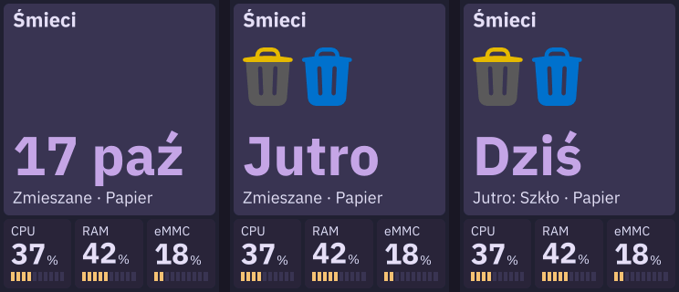

# kafel-waste

Demon C++ czyta lokalny harmonogram i publikuje duży kafel „Śmieci” przez
DASH/5: własne kolorowe SVG kubłów i podpis Dziś/Jutro lub dzień i skrót miesiąca najbliższego
odbioru. Dashboard nie zna frakcji ani reguł kalendarza.

## Dane i konfiguracja

Trwały harmonogram: `/var/lib/kafel-waste/garbage_schedule.json`.
To dane użytkownika, niezależne od wydań binarnych i ignorowane przez Git.
Deploy zachowuje backup i nie nadpisuje harmonogramu. Migracja i kopie:
[dokumentacja wdrażania](../../docs/deploy.md).

```json
{
  "timezone": "Europe/Warsaw",
  "pickups": [
    {"date": "2026-10-17", "fraction": "paper"},
    {"date": "2026-10-17", "fraction": "plastic"},
    {"date": "2026-10-18", "fraction": "glass"}
  ]
}
```

Przykład jest syntetyczny. Dni są sortowane, frakcje tego samego dnia grupowane,
a duplikaty deduplikowane. Wybór daty używa strefy z harmonogramu, także przy
DST, przełomie roku i latach przestępnych. Demon nigdy nie zapisuje źródła.

`/etc/kafel/waste.env`: obowiązkowe `KAFEL_WASTE_SCHEDULE` i opcjonalne
`KAFEL_DASHBOARD_SOCKET`. Domyślny socket `/tmp/kafel-<uid>/dashboard.sock`.
Nie ma parametru szerokości: usługi publikują duże kafle 240×240.

## Stan i prezentacja

| Frakcja | Kolor |
|---|---|
| `mixed` | korpus `#5B5B5B`, pokrywa `#E6B800` |
| `glass` | `#008F39` |
| `paper` | `#0072CE` |
| `plastic` | `#E6B800` |
| `kitchen` | `#A0522D` |
| `garden` | `#008F39` |

Heroicons Trash Solid skaluje się wektorowo. Zmieszane mają ciemnoszary korpus
`#5B5B5B` i żółtą pokrywę z uchwytem `#E6B800`. Podział powstaje offline jako dwie
zwykłe ścieżki SVG. Nie wymaga maski ani dodatkowej biblioteki na CM4.

Widok pozostaje stały między zmianami daty lub harmonogramu:

| Sytuacja | Główna wartość | Kubły | Dolny wiersz |
|---|---|---|---|
| Dziś/jutro bez odbioru | dzień + skrót miesiąca | brak | frakcje najbliższego odbioru |
| Brak odbioru dziś, odbiór jutro | Jutro | jutrzejsze | jutrzejsze frakcje |
| Odbiór dziś, następny jutro | Dziś | dzisiejsze | `Jutro: frakcje` |
| Odbiór dziś, następny później | Dziś | dzisiejsze | `20 paź: frakcje` |
| Odbiór dziś, bez dalszych terminów | Dziś | dzisiejsze | `Brak kolejnych terminów` |

Długi dolny wiersz przewija dashboard, bez zmiany głównej wartości ani ikon.
Heartbeat nie przełącza Dziś/Jutro. Flaga attention jest ustawiana dla dzisiejszego
lub jutrzejszego odbioru. Brak przyszłych terminów daje warning `Brak terminów`;
brak harmonogramu daje error/missing bez starej treści.

Odczyt poprawnego pliku co 60 s; po błędzie retry co 30 s. Błąd przeładowania
zachowuje kompletny ostatni harmonogram i publikuje warning/stale. Heartbeat
DASH/5 co 5 s nie wymaga odczytu pliku. Zmiana kubłów/podpisu nie jest animacją
wysyłaną jako piksele; jest zwykłym atomowym snapshotem danych.

## Budowa i wdrażanie

```sh
zig build waste-test -Doptimize=ReleaseFast
zig build waste
zig build deploy-waste
```

Pierwsza migracja protokołu wymaga **`zig build deploy` dla trzech aplikacji**.
Późniejsze zgodne wdrożenia Śmieci nie restartują pozostałych usług.
Diagnostyka pliku: `kafel-waste --check FILE`; identyfikacja: `--version`.

`assets/template.json` opisuje kompozycję. `assets/bundle.json` zawiera szablon
i 64 możliwe kombinacje sześciu kubłów; tylko potrzebne SVG są przesyłane.
Odtwarzanie bez zależności graficznych:

```sh
python3 scripts/prepare_service_assets.py --app waste
```

Build sprawdza odtwarzalność bundle. Testy zachowują regresje kalendarza, cache,
plików i palety oraz sprawdzają realny stream, uploady, heartbeat i SIGTERM.

Długi podpis frakcji korzysta z `overflow: "marquee"` w szablonie: przewijanie
wahadłowe z pauzami na obu końcach. Krótki podpis jest nieruchomy. Demon publikuje
pełny tekst; przesuwanie pozostaje odpowiedzialnością ogólnego renderera UI.

Ilustracje korzystają z **Heroicons Trash Solid**, Tailwind Labs, MIT. Oryginał,
wersja i licencja: `vendor/heroicons`. Sylwetki zachowują proporcje i mają 64 px
wysokości przy maksymalnie trzech frakcjach; większa grupa skaluje się proporcjonalnie
do szerokości kafla. `caption` zawiera cały główny napis: „Dziś”, „Jutro”
albo np. „17 paź”. Całość ma stałe 60 px, bez osobnego pola miesiąca
i zmiany rozmiaru jego czcionki.

### Odtworzenie dwukolorowego SVG

`python3 scripts/prepare_waste_icon.py` generuje `mixed-bin.svg` oraz metadane SHA-256.
To jednorazowy krok offline z narzędziami z `scripts/requirements-weather-icons.txt`.
Następnie `python3 scripts/prepare_service_assets.py --app waste` odświeża bundel.
Zwykły build Zig korzysta z gotowych plików i nie wymaga tych pakietów.


