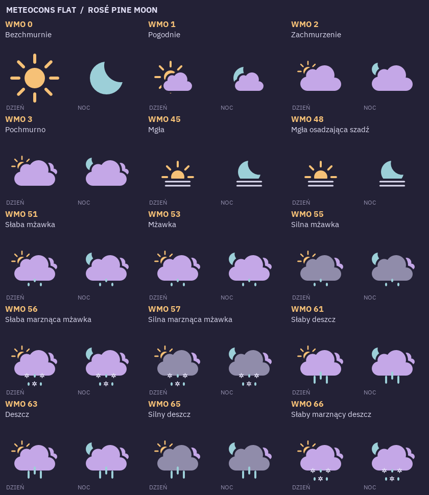
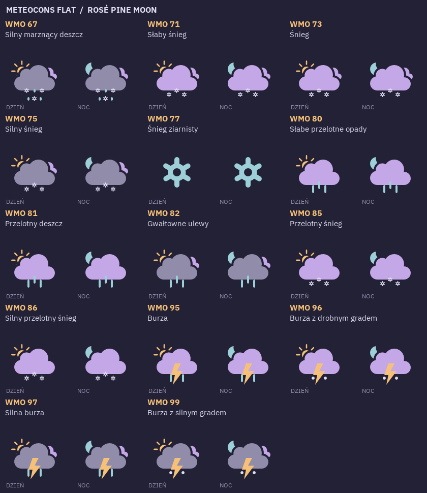

# Meteocons Flat — pełny katalog Pogody

29 kodów WMO × dzień/noc = 58 wyborów; 40 unikalnych zasobów SVG,
w tym `not-available` dla nieznanych kodów. Mapowanie i polskie opisy żyją
wyłącznie w `apps/weather/src/appearance.cpp`. JSON katalogu i plansze
powstają z tego samego kodu C++, przez pogodowe narzędzie `kafel-weather-catalog`.
Źródłowe przygotowane SVG i `catalog.json` należą do
[`apps/weather/assets/icons`](../../../../../../apps/weather/assets/icons/README.md).
Ten katalog zawiera wyłącznie przegląd, gotowe obrazy i przykładowe kompozycje.




Po lewej dzień, po prawej noc w każdej komórce. Śnieżynka dla WMO 77
jest niezależna od pory dnia. Intensywności mogą współdzielić ikonę;
pełną semantykę zachowuje opis. `sleet` jest wizualnym przybliżeniem
marznących opadów, a mgła z szadzią dzieli ikonę zwykłej mgły.

## Przygotowanie i odtwarzanie

Oryginały: `vendor/meteocons-static/flat`, pakiet `@meteocons/svg-static` 0.1.0,
MIT, Bas Milius. Integralność archiwum i SHA-256 plików zapisano w
`vendor/meteocons-static/VERSION.json`. Przygotowane ikony należą do `apps/weather/assets/icons`; oryginały pozostają
nienaruszone. Paleta: Rosé Pine Moon.

NanoSVG nie obsługuje masek. Przygotowanie offline przecina ścieżki z pełnymi,
nieprzezroczystymi maskami alfa przy użyciu Skia PathOps. Wycięcia nie są
usuwane ani zamalowywane kolorem tła: wynik to nadal niezależna, przezroczysta
grafika wektorowa. Maski luminancji, półprzezroczyste maski i nieznane cechy
są odrzucane. Można usunąć wyłącznie klip całego viewportu 128×128.
Nie dodaliśmy obsługi masek ani meteorologii do renderera.

```sh
python3 -m venv /tmp/kafel-icons
/tmp/kafel-icons/bin/pip install -r scripts/requirements-weather-icons.txt
zig build weather-catalog weather-card-bin -Doptimize=ReleaseFast
/tmp/kafel-icons/bin/python scripts/prepare_weather_icons.py
/tmp/kafel-icons/bin/python scripts/render_weather_catalog.py
/tmp/kafel-icons/bin/python -m unittest discover -s scripts/tests -p test_weather_icons.py
zig build test -Doptimize=ReleaseFast
```

Narzędzia Python służą tylko do odtwarzania zasobów i planszy. Normalny build
i CM4 nie potrzebują PathOps, FontTools ani Pillow. Gotowe SVG są wersjonowane.
Rasteryzacja ikon i czterech przykładowych kafli 240×240 odbywa się w C++ przez
nasz renderer; Pillow jedynie układa planszę i podpisy. Pogodowy `apps/weather/assets/icons/catalog.json` zapisuje hash źródła i przygotowanego
SVG, a lokalny `rendered.json` hash wynikowych obrazów.

Testy Zig renderują wszystkie 58 wyborów rzeczywistym NanoSVG, kontrolują
komplet kodów, warianty dzień/noc i fallback. Testy offline sprawdzają wycięcie
otworu maski, odrzucenie nieobsługiwanych masek i odtwarzalność bajt w bajt.
Testy integralności nie wymagają instalowania narzędzi offline.

To osobny przegląd zasobów. Produkcyjna Pogoda osadza te SVG w swoim bundle
i publikuje wybrane hashe przez DASH/5. Sam przegląd nie jest wdrażany na CM4.
